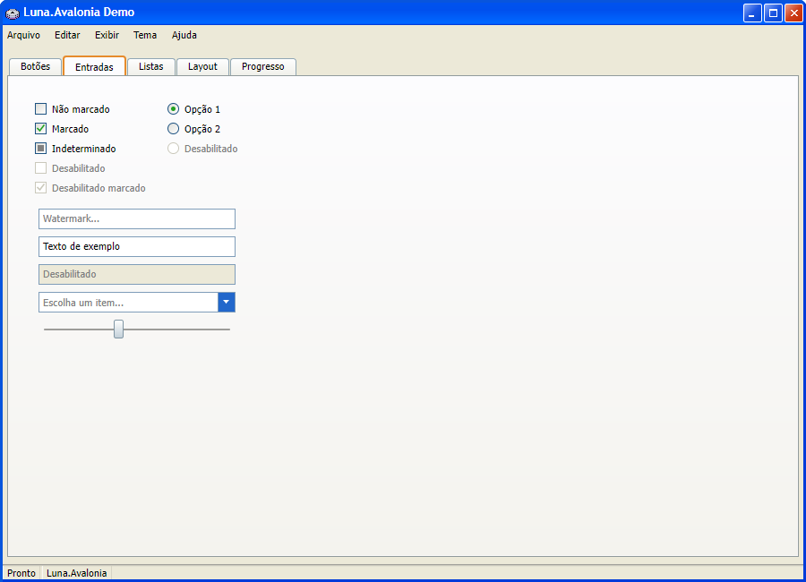
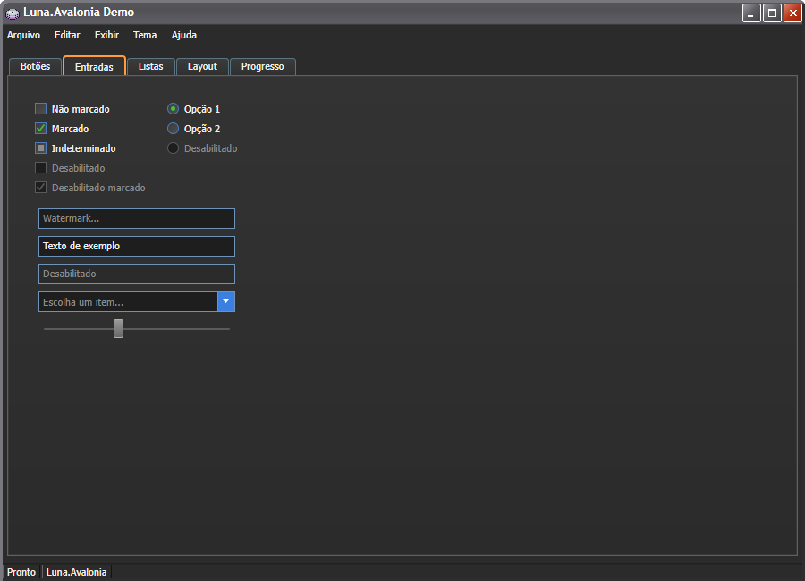
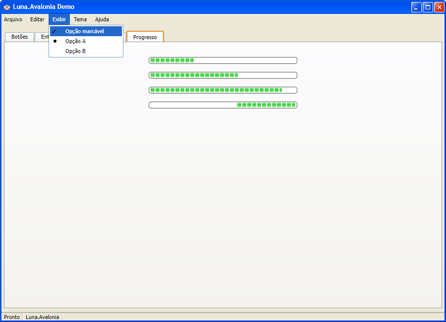

# Luna.Avalonia

A Windows XP "Luna" (Blue) visual theme for [Avalonia UI](https://avaloniaui.net/), ported from
[XP.css](https://github.com/botoxparty/XP.css) - plus an original Dark variant inspired by the Silver theme.

## Screenshots

The demo app from `samples/Luna.Avalonia.Demo`, with the window chrome drawn by the theme.

Blue variant (check boxes, radio buttons, text boxes, combo box, slider):



Dark variant, same controls:



Menu with checkable and radio items, over determinate and indeterminate progress bars:



## Requirements

- **Avalonia 11.3.22 or a later 11.x release. Avalonia 12 is not supported yet.** Luna draws its
  window chrome by restyling Avalonia 11's managed `TitleBar` and `CaptionButtons`, which
  Avalonia 12 replaced with a new window decorations system, and the title bar breaks there. The
  package caps its Avalonia dependency below 12.0.0 until the chrome is ported.
- .NET 8 or later.
- Developed and tested on Windows.

## Quick start

These steps start from a new app made with the Avalonia templates.

1. Create the app with the Avalonia 11 templates. Pass `-av 11.3.22`: the templates default to an
   older 11.3 release, and NuGet refuses to restore an app that references a lower Avalonia
   version than Luna needs (error NU1605).

   ```
   dotnet new install Avalonia.Templates::11.3.12
   dotnet new avalonia.app -o MyApp -av 11.3.22
   ```

2. Add Luna.Avalonia to the app. It is not on NuGet yet, so clone this repository next to the
   app and reference the project:

   ```
   git clone https://github.com/Acanixz/Luna.Avalonia.git
   dotnet add MyApp reference Luna.Avalonia/src/Luna.Avalonia/Luna.Avalonia.csproj
   ```

3. In `MyApp/App.axaml`, replace `<FluentTheme />` with `<LunaTheme />`:

   ```xml
   <Application xmlns="https://github.com/avaloniaui"
                xmlns:x="http://schemas.microsoft.com/winfx/2006/xaml"
                x:Class="MyApp.App"
                RequestedThemeVariant="Default">
     <Application.Styles>
       <LunaTheme />
     </Application.Styles>
   </Application>
   ```

   No extra `xmlns` is needed, because Luna registers its types under the default Avalonia
   namespace. The `Avalonia.Themes.Fluent` package the template added is no longer used and can
   be removed with `dotnet remove MyApp package Avalonia.Themes.Fluent`.

4. Run the app:

   ```
   dotnet run --project MyApp
   ```

   The template sets `RequestedThemeVariant="Default"`, so the app follows the Windows setting:
   Blue in light mode, Dark in dark mode. To pick one variant, see [Theme variants](#theme-variants).

## Theme variants

Luna has two variants: `LunaTheme.Blue`, the classic Luna look, and `LunaTheme.Dark`, an original
dark palette (Windows XP never shipped one). With `RequestedThemeVariant` unset or set to
`Default`, the app follows the system's light/dark preference. To force one variant regardless of
the OS, set it in `App.axaml`:

```xml
<Application ...
             RequestedThemeVariant="{x:Static LunaTheme.Blue}">
```

or in code:

```csharp
using Avalonia.Styling;
using Luna.Avalonia;

Application.Current.RequestedThemeVariant = LunaTheme.Dark;       // force dark
Application.Current.RequestedThemeVariant = ThemeVariant.Default; // follow the OS again
```

See `samples/Luna.Avalonia.Demo` for a runnable showcase of every themed control, including a
"Tema" menu to switch between Blue, Dark and "follow the system" live.

## Authorship

Luna.Avalonia is developed by [Acanixz](https://github.com/Acanixz). Its code was written by
Claude, Anthropic's AI model, under Acanixz's direction and review, using
[XP.css](https://github.com/botoxparty/XP.css) and
[Classic.Avalonia](https://github.com/BAndysc/Classic.Avalonia) as references.

## License

MIT - see [LICENSE](LICENSE). Luna.Avalonia is a port of
[XP.css](https://github.com/botoxparty/XP.css) (MIT, Copyright 2020 Adam Hammad, Jordan Scales)
and includes controls ported from [Classic.Avalonia](https://github.com/BAndysc/Classic.Avalonia)
(MIT, Copyright (c) 2024 BAndysc); both copyright and permission notices are reproduced in
[LICENSE](LICENSE), under "Third-party notices". The vendored MS Sans Serif fonts carry their own
CC BY-SA 3.0 license - see `src/Luna.Avalonia/Assets/Fonts/ATTRIBUTION.txt`.
